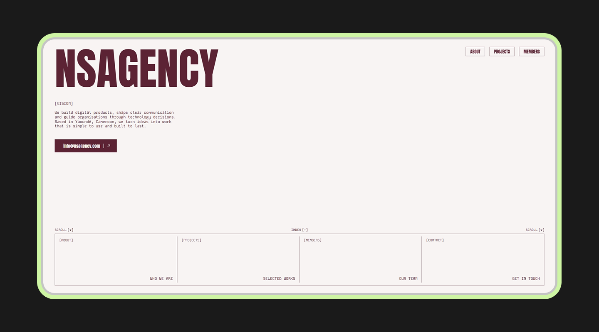
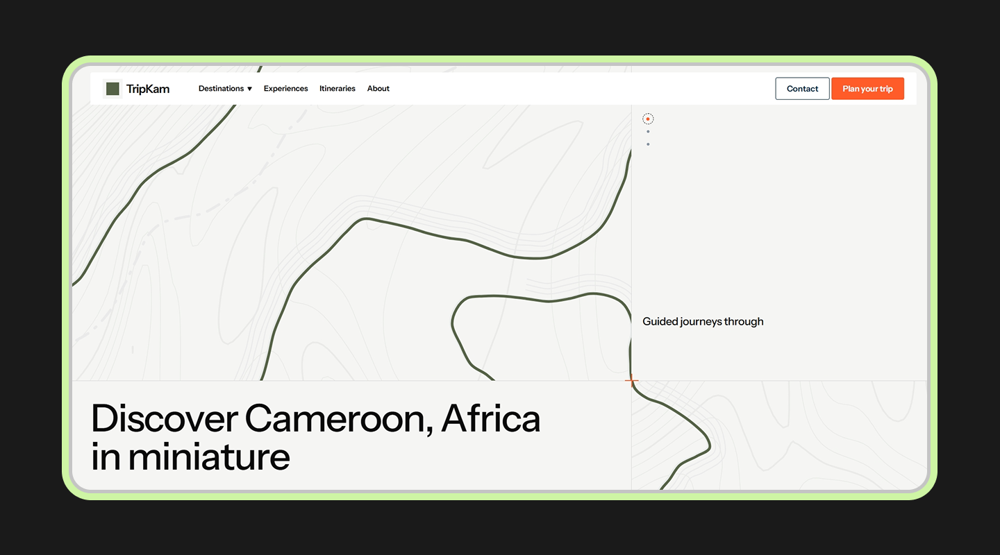

# Pages

Free, open-source landing pages in plain HTML, React and Next.js. Use them, learn from them, build on them.

Every page is a self-contained project: copy a folder, run it, make it yours.

## Projects

| Preview                                                                                                                                          | Project                                                                     | Stack                                     | Concept                                                                                          |
| ------------------------------------------------------------------------------------------------------------------------------------------------ | --------------------------------------------------------------------------- | ----------------------------------------- | ------------------------------------------------------------------------------------------------ |
| <a href="https://ns-agency.heysimplice.com/"></a> | [**NSAGENCY**](Next/ns-agency) · [Live](https://ns-agency.heysimplice.com/) | Next.js, Tailwind CSS, GSAP, Lenis        | A bold, typographic landing page for a digital agency based in Yaoundé, Cameroon                 |
| <a href="https://ns-trip.heysimplice.com"></a>      | [**NSTRIP**](React/ns-trip) · [Live](https://ns-trip.heysimplice.com)       | React 19, Vite, Tailwind CSS, GSAP, Lenis | A tourism landing page for Cameroon, with a drawn topographic map and scroll-driven storytelling |

More pages are on the way in `Html/`, `React/` and `Next/`.

## Repository structure

```
pages/
├── Html/                 Plain HTML, CSS and JavaScript. No build step
├── React/                React landing pages (Vite, Tailwind CSS)
│   └── ns-trip/
├── Next/                 Next.js landing pages (App Router, Tailwind CSS)
│   ├── ns-agency/
│   └── designerfolio/
└── websites-captures/    Screenshots used in this README, one folder per stack
```

## Run locally

Each folder inside `Next/` and `React/` is an independent project. It needs Node.js 20.19 or later. From the repository root:

```bash
cd Next/ns-agency      # or another project
npm install
npm run dev
```

Then open [http://localhost:3000](http://localhost:3000). For a production build, run `npm run build`, then `npm start`.

Plain HTML pages need no tooling. Open the page's `index.html` in your browser, or serve the folder:

```bash
cd Html/<project>
python -m http.server 8000
```

## Deploy

Deploy each page as its own project on [Vercel](https://vercel.com). Import this repository once per page and set the **Root Directory** to that page's folder:

| Site         | Root Directory    | Framework preset     |
| ------------ | ----------------- | -------------------- |
| Next.js page | `Next/<project>`  | Next.js              |
| React page   | `React/<project>` | Vite                 |
| HTML page    | `Html/<project>`  | Other, no build step |

Leave the build command and output directory at their defaults.

## Contributing

Contributions are welcome: new pages, fixes and improvements.

1. Add your page in the folder that matches its stack.
2. Keep it self-contained, so it installs and runs on its own.
3. Add a screenshot to `websites-captures/<stack>/<project>.png` and a row to the Projects table.
4. Open a pull request.

## Author

Created by Njoh. See more of my work at [heysimplice.com](https://heysimplice.com/).
